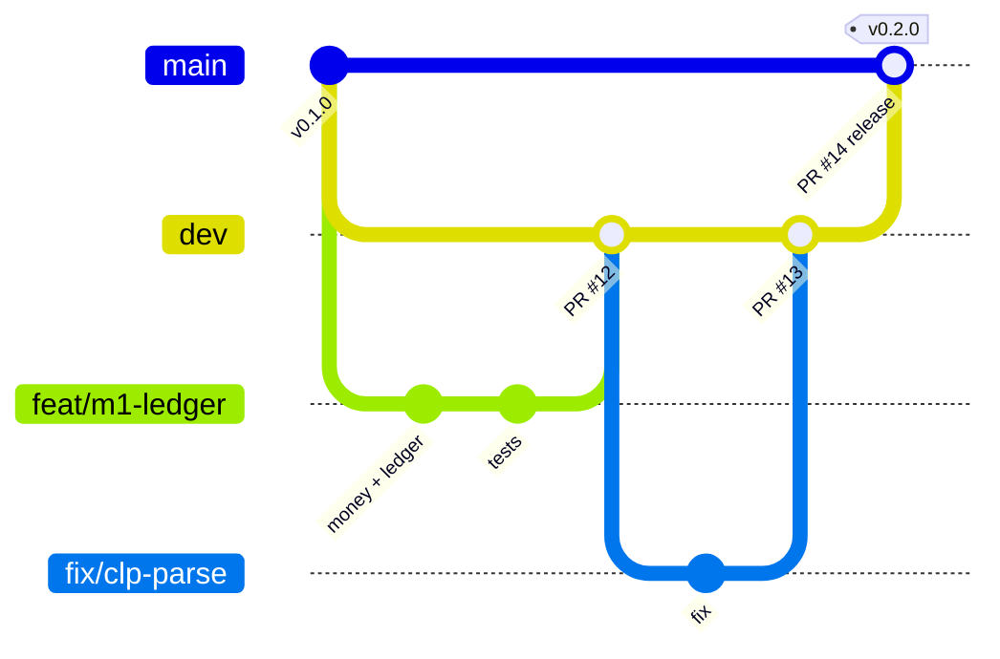

# Contributing & Branching Strategy

## Branches

| Branch | Purpose | How it changes |
|---|---|---|
| `main` | Released, always-green code. Tags `vX.Y.Z` are cut here. | **Only** by a PR from `dev`. |
| `dev` | Integration branch; next release. | **Only** by PRs from short-lived branches. |
| `feat/*`, `fix/*`, `docs/*`, `chore/*`, `refactor/*`, `test/*` | One change each. | Branch off `dev`, PR back into `dev`. |
| `hotfix/*` | Urgent fix for a release. | Branch off `dev`, PR into `dev`, then promote `dev → main`. |



## Rules (enforced by GitHub rulesets + CI)

**`main`**
- No direct pushes, no force pushes, no deletion.
- Changes only through pull requests.
- The PR's source branch must be `dev` — the required `branch-policy` CI check fails for anything else.
- Required checks: `branch-policy`, `guardrails`, `rust`, `frontend`.
- Merge method: **merge commit** (keeps `dev` and `main` histories aligned).

**`dev`**
- No direct pushes, no force pushes, no deletion.
- Changes only through pull requests.
- Required checks: `guardrails`, `rust`, `frontend`.
- Merge method: **squash** (one commit per feature/fix).

## Workflow

```bash
git switch dev && git pull
git switch -c feat/m1-ledger
# ...work, commit (Conventional Commits)...
git push -u origin feat/m1-ledger
gh pr create --base dev --fill
# after CI is green → squash-merge into dev
# release: open PR dev → main, merge commit, tag vX.Y.Z on main
```

## Commit messages
[Conventional Commits](https://www.conventionalcommits.org/): `feat:`, `fix:`, `docs:`, `test:`, `refactor:`, `chore:`, `ci:`. Scope by crate or area when useful: `feat(money): parse UF amounts`.

## Before opening a PR
- `docker compose --profile test run --rm test-back` and `... test-front` pass (or the native equivalents in [docs/08-development.md](docs/08-development.md)).
- New domain behavior has Rust unit tests; no money math outside Rust; no SQL triggers/views.
- No secrets, real statements, or personal financial data (see [SECURITY.md](SECURITY.md)).
- Docs/ADRs updated if a decision changed.
