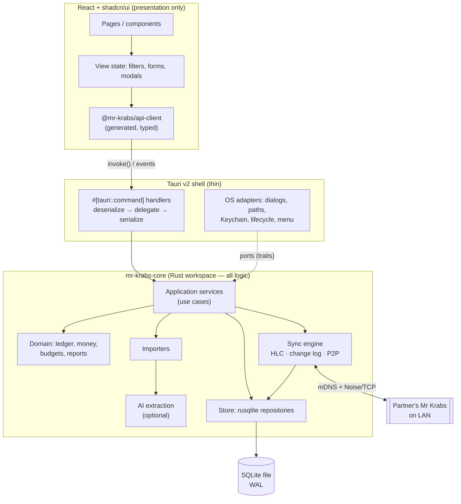
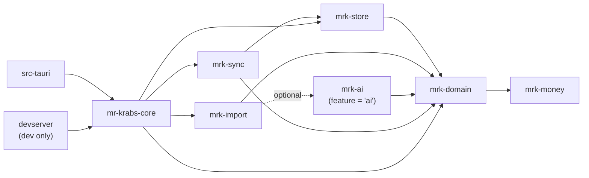
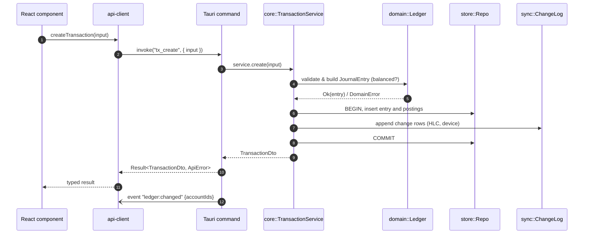
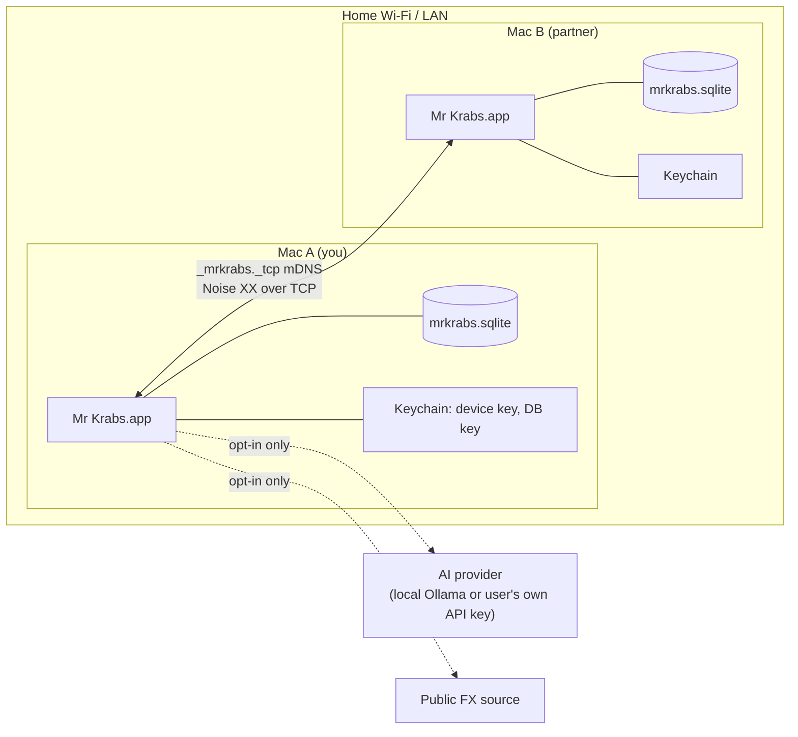

# 02 · Architecture

## Layers at a glance



### Responsibilities & hard rules

| Layer | Owns | Must never |
|---|---|---|
| **React UI** | Layout, rendering DTOs, local view state, form input capture, charts (rendering pre-computed series), i18n strings. | Add, subtract, convert or aggregate money; call `@tauri-apps/api` directly (only via `api-client`); read files. |
| **api-client** (TS) | Generated types + thin `invoke` wrappers, event subscriptions, error mapping. | Contain business logic. |
| **Tauri shell** | Window, menus, file dialogs, app paths, Keychain, auto-start of sync, wiring core to OS adapters. | Run SQL, compute balances, validate domain rules. Each command ≤ ~10 lines. |
| **mr-krabs-core** | Everything else: validation, ledger invariants, money math, FX, budgets, reports, import parsing, dedup, sync, migrations. | Depend on Tauri, React, or macOS APIs (OS needs are *ports* = traits implemented by the shell). |
| **SQLite** | Durable storage, indexes, `CHECK`/`FOREIGN KEY`/`UNIQUE` constraints. | Triggers, views with logic, UDFs with side effects, stored procedures. |

> Constraints like `CHECK (amount_minor <> 0)` and foreign keys are **allowed** — they are integrity guards, not business logic. Business rules (balanced entries, budget math) live in Rust.

## Repository layout

```text
mr-krabs/
├── Cargo.toml                    # Rust workspace
├── package.json / pnpm-workspace.yaml
├── crates/
│   ├── mrk-money/                # Money, Currency, FxRate, rounding — no deps on anything else
│   ├── mrk-domain/               # Entities, ledger invariants, budgets, reports (pure, no IO)
│   ├── mrk-store/                # rusqlite repositories, migrations (*.sql, no triggers)
│   ├── mrk-import/               # CSV/XLSX/PDF parsers, bank profiles, dedup, staging
│   ├── mrk-ai/                   # Optional LLM extraction (feature-gated), provider trait
│   ├── mrk-sync/                 # HLC, change log, protocol, mDNS, Noise transport, pairing
│   └── mr-krabs-core/            # Facade: application services + DTOs + command catalogue
├── apps/
│   ├── devserver/                # Dev-only HTTP shell over the core (docker compose `back`, ADR-0007)
│   └── desktop/
│       ├── src-tauri/            # Tauri v2 shell (depends ONLY on mr-krabs-core)
│       │   ├── src/commands/*.rs
│       │   ├── src/adapters/     # Keychain, paths, dialogs implementing core ports
│       │   └── tauri.conf.json
│       └── src/                  # React app (Vite + TS + Tailwind + shadcn/ui)
│           ├── components/ui/    # shadcn generated components
│           ├── features/         # accounts/, transactions/, budgets/, reports/, import/, sync/, settings/
│           ├── routes/
│           └── lib/              # formatting helpers (display only), hooks
├── packages/
│   └── api-client/               # Generated bindings (tauri-specta) + typed wrappers
├── docker/                       # back.Dockerfile, front.Dockerfile (dev images)
├── compose.yaml                  # back + front + db (+ test profile)
├── docs/
├── tools/
│   ├── check-no-sql-logic.sh     # CI: fail on CREATE TRIGGER/VIEW/PROCEDURE in migrations
│   └── gen-bindings.sh
└── .github/workflows/ci.yml      # branch policy, fmt, clippy, tests, eslint, typecheck, docker, gitleaks
```

### Crate dependency graph (enforced by Cargo)



`src-tauri` and `devserver` depend **only** on `mr-krabs-core`. `mrk-domain` has no IO dependencies (no `rusqlite`, no `tokio`), so all financial rules are testable as pure functions.

### Boundary enforcement

| Boundary | Mechanism |
|---|---|
| No floats in money | `clippy.toml`: `disallowed-types = ["f32", "f64"]` in `mrk-money`, `mrk-domain`; `#![deny(clippy::float_arithmetic)]`. |
| No SQL logic | `tools/check-no-sql-logic.sh` greps migrations + `.rs` SQL strings for `TRIGGER`, `CREATE VIEW`, `PROCEDURE`, `create_function`. CI fails on hit. |
| Tauri stays thin | Shell depends only on `mr-krabs-core`; review rule: commands contain no `rusqlite`, no arithmetic. |
| React stays presentational | ESLint `no-restricted-imports` for `@tauri-apps/*` outside `packages/api-client`; money values arrive as `MoneyDto` with a pre-formatted string; no arithmetic helpers exported for money. |

## Runtime view

### Command request (e.g. create transaction)



### Process & threads
- Tauri main thread: UI/IPC.
- Core runs on a **tokio** runtime owned by the shell: one **writer** connection (serialized through an `mpsc` actor) + a small pool of **read** connections (WAL allows concurrent reads).
- Sync engine is a background task: mDNS browser/advertiser, TCP listener, per-peer session tasks.
- AI extraction runs as a cancellable background job emitting progress events.

## Deployment view



Data location: `~/Library/Application Support/cl.mrkrabs.app/` (`mrkrabs.sqlite`, `attachments/`, `backups/`).

## Cross-cutting concerns

| Concern | Approach |
|---|---|
| Errors | `thiserror` in core → `ApiError { code, message, details }` (serializable, stable `code` enum). UI maps `code` to i18n text. |
| Logging | `tracing` to rotating local file; never logs amounts/descriptions at `info`; no remote sink. |
| Migrations | Forward-only numbered SQL files embedded in `mrk-store`, run at startup inside a transaction; schema version in `PRAGMA user_version`. Sync refuses peers with incompatible schema. |
| Time | Dates of transactions are civil `NaiveDate` (no TZ); audit timestamps are HLC (UTC ms + counter). |
| IDs | UUIDv7 everywhere (time-ordered, globally unique, good B-tree locality). |
| i18n | `es-CL` default, `en`. Number formatting performed in Rust (`MoneyDto.display`) to guarantee consistency; UI may use `Intl` for non-money numbers. |
| Testing | Unit + property tests (proptest) in domain; repository tests on in-memory SQLite; importer golden files; sync simulation tests (two in-process peers with random offline edits); Playwright/Tauri driver smoke tests. |
