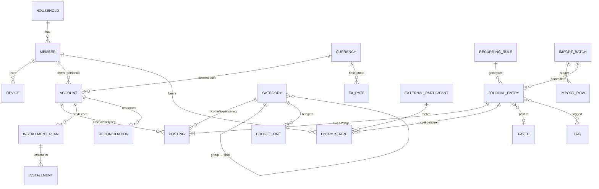

# 03 · Data Model

The authoritative schema is the migrations in [`crates/mrk-store/migrations/`](../crates/mrk-store/migrations/), applied in order: `0001_init.sql`, then `0002_ledger_legs_and_category_keys.sql`. 0002 implements the accepted schema review in [`db-review/proposal/proposal.md`](db-review/proposal/proposal.md). This document explains the schema and the Rust domain types that sit on top. Some sections below still describe 0001 and are updated with the proposal's docs step.

## Principles

1. **Ledger is the source of truth.** Balances, budget actuals, net worth and cash flow are **derived** in Rust from postings; nothing derived is stored as truth (caches, if ever added, are disposable).
2. **Double entry.** A user-facing *transaction* is a `journal_entry` with ≥ 2 `posting`s. Category legs act as nominal (income/expense) accounts. Per currency, postings sum to **zero** — enforced in Rust before every write.
3. **Integer money.** `amount_minor: i64` + `currency_code`. CLP has 0 minor units, USD 2, UF (`CLF`) 4.
4. **SQLite is dumb storage.** Only `PRIMARY KEY`, `FOREIGN KEY`, `UNIQUE`, `NOT NULL` and simple `CHECK` guards. No triggers/views/procedures.
5. **Sync-ready from day one.** UUIDv7 IDs, `hlc`/`hlc_device`/`deleted` on every replicated row, append-only `change_log`.

## Entity–relationship diagram



## How common transactions are recorded

All amounts below in CLP (0 decimals). Positive = debit (increase of assets/expenses), negative = credit.

| Situation | Postings | Notes |
|---|---|---|
| Supermarket paid with debit card | `checking −45 000` · `cat:Supermercado +45 000` | Expense. |
| Salary | `checking +1 000 000` · `cat:Sueldo −1 000 000` | Income (credit to income category). |
| Move money to emergency fund | `checking −100 000` · `savings +100 000` | **Transfer**: no category leg → never counted as expense (FR-TX-02). Reported as "saved". |
| Credit card purchase, 6 *cuotas* of 20 000 | `card −120 000` · `cat:Compras casa +120 000` + `installment_plan` (6 rows) | Liability grows by total (as banks do). Budget impact per installment month if `budget_mode = per_installment` (computed in Rust). |
| Pay credit card | `checking −300 000` · `card +300 000` | Transfer (FR-TX-05). |
| Card interest | `card −3 500` · `cat:Intereses +3 500` | Expense. |
| Shared rent paid by A from personal account, 50/50 | `A.checking −600 000` · `cat:Arriendo +600 000`; `is_shared=1`, `payer=A`, shares: A 300 000, B 300 000 | Settle-up: B owes A 300 000 (computed in Rust). |
| B settles with A | `B.checking −300 000` · `A.checking +300 000`, `kind=settlement` | Clears the balance; not an expense. |
| Subscription split 3-way with a friend outside the household | `card −15 000` · `cat:Streaming +10 000` · `Por cobrar +5 000` | Only the household's share is an expense. The friend's share goes to a system *receivable* account (`kind = other_asset`, "Cuentas por cobrar") and is linked through `entry_share.participant_id`; their reimbursement (`checking +5 000` · `Por cobrar −5 000`) sets `settled_entry_id`. |
| USD purchase on card's international section | `card_usd −2 500` (USD minor = 25.00) · `cat:Software +2 500` (USD) | Reports convert to CLP with the rate of the date (Rust). |
| Pay USD card section in CLP | `checking −23 750 (CLP)` · `fx:CLP +23 750` · `fx:USD −2 500` · `card_usd +2 500 (USD)` | `fx_exchange` entry balances per currency through an FX trading pair; both amounts are recorded, the rate is implied and auditable. |

## Categories are data

- A category is a row in `category`, referenced everywhere by its ID; **no code path names a specific category**. The seed tree is inserted as ordinary rows on household creation and can be edited or deleted like anything else (FR-BU-01).
- `parent_id` forms a tree of **any depth**. A child's `kind` must equal its parent's. Schema v2 declares this as a composite foreign key `(parent_id, kind) → category(id, kind)`, which is a plain constraint, not SQL logic. `mrk-domain` also checks it, and keeps `kind` immutable. Cycles are rejected by `mrk-domain` before every write.
- Any node can be a posting leg or carry a budget line. Reports roll a node's amounts up through its descendants in Rust (FR-BU-08).
- `kind` is only `income` or `expense`. Savings and investments are **accounts**, so money moved there is a transfer with no category leg (FR-TX-02).
- Delete = merge: re-point the category's postings and budget lines to a chosen target, then soft-delete it, in one transaction (FR-BU-07). Archive sets `is_archived` and keeps history intact.
- Imports resolve categories by normalized name (case- and accent-insensitive) in Rust; unresolved names stay in staging until the user maps or creates them (FR-IM-07).

Planned schema additions (forward migrations, M5): `payee_rule` in 0001 holds one condition and two actions; the staged rules engine (FR-TX-10) extends it with a stage and condition/action lists. The local categorizer (FR-TX-12) needs **no table**: its word → category model is derived in Rust from the categorized entries already in the ledger (principle 1), so it is rebuilt on demand, both devices learn from synced history, and there are no counters to conflict.

## Rust domain model (sketch)

```rust
// mrk-money
#[derive(Copy, Clone, Eq, PartialEq, Hash, Debug, Serialize, Deserialize)]
pub struct CurrencyCode([u8; 8]);              // "CLP", "USD", "CLF"

#[derive(Copy, Clone, Eq, PartialEq, Debug)]
pub struct Money { pub minor: i64, pub currency: CurrencyCode }

impl Money {
    pub fn checked_add(self, o: Money) -> Result<Money, MoneyError>;   // errors on currency mismatch / overflow
    pub fn neg(self) -> Money;
    pub fn allocate(self, ratios: &[u32]) -> Vec<Money>;               // largest-remainder; sums exactly (splits, cuotas)
}
pub struct FxRate { pub base: CurrencyCode, pub quote: CurrencyCode, pub date: NaiveDate, pub rate: Decimal }
pub fn convert(m: Money, rate: &FxRate, to_minor_units: u8, mode: RoundingMode) -> Money;

// mrk-domain
pub struct EntryId(Uuid); pub struct AccountId(Uuid); /* … newtypes for every ID … */

pub enum Leg { Account(AccountId), Category(CategoryId), FxTrading(CurrencyCode) }
pub struct Posting { pub id: PostingId, pub leg: Leg, pub amount: Money, pub memo: String }

pub struct JournalEntry {
    pub id: EntryId, pub date: NaiveDate, pub kind: EntryKind, pub status: EntryStatus,
    pub payee: Option<PayeeId>, pub description: String, pub memo: String,
    pub postings: Vec<Posting>,
    pub sharing: Option<Sharing>,          // payer + shares (members / external participants)
    pub attributed_to: Option<MemberId>,
    pub installment_plan: Option<InstallmentPlanId>,
    pub origin: EntryOrigin,               // Manual | Recurring(RuleId) | Import(BatchId)
}

impl JournalEntry {
    /// The single place where "is this a valid transaction?" is decided.
    pub fn validate(&self, ctx: &LedgerContext) -> Result<(), DomainError> {
        // ≥2 postings; per-currency sum == 0; account currency == posting currency;
        // transfers have no category legs; shares sum to expense total; archived accounts rejected; …
    }
}

pub struct InstallmentPlan { /* total, n, rate, first_due_month */ }
impl InstallmentPlan { pub fn schedule(&self) -> Vec<Installment>; } // exact, uses Money::allocate

// Reports are pure functions over postings
pub fn account_balances(postings: &[PostingRow], as_of: NaiveDate) -> BTreeMap<AccountId, Money>;
pub fn cash_flow(postings: &[PostingRow], period: Period, view: Scope, fx: &FxTable) -> CashFlow;
pub fn budget_matrix(budget: &[BudgetLine], postings: &[PostingRow], year: i32, view: Scope, mode: BudgetMode) -> BudgetMatrix;
pub fn settle_up(entries: &[SharedEntry]) -> Vec<Debt>;  // who owes whom
```

Pure report functions take rows loaded by `mrk-store` (simple `SELECT … WHERE date BETWEEN` queries); SQL never aggregates money with business meaning. `SUM()` in SQL is **not** used for money results shown to users — Rust performs aggregation so rounding, FX and scope rules live in one place.

### Scope / view resolution (Rust)

| View | Included accounts | Shared entries count as |
|---|---|---|
| **Personal (me)** | my personal accounts | my share only |
| **Household** | household accounts + shared entries from personal accounts | full amount |
| **Combined** | everything visible to me | full amount, settlements eliminated |

Partner's `private` accounts never exist on my device (filtered at sync, see [05](05-sync.md)).

## Indexing strategy
- Postings by `(account_id, entry_id)` and `(category_id, entry_id)` partial indexes on `deleted = 0`.
- Entries by `entry_date` for period scans; `fingerprint` for dedup; `import_batch_id` for undo.
- `change_log(device_id, hlc)` for "send me everything after X from device D".
- Expected scale: ~5 000 entries/year/household → 100k postings over 10 years; full scans in Rust are well under 100 ms.

## Migrations
- Embedded SQL files `NNNN_name.sql`, applied in order in one transaction, `PRAGMA user_version = N`.
- CI check rejects `CREATE TRIGGER`, `CREATE VIEW`, `CREATE PROCEDURE`, `create_function` (see `tools/check-no-sql-logic.sh`).
- Sync handshake exchanges `user_version`; peers with different schema versions sync only after both upgrade.
