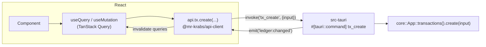

# 04 · Command Boundary (React ⇄ Rust)

## Design



- **Two transports, one API.** `@mr-krabs/api-client` uses Tauri IPC inside the desktop app and HTTP (`POST /api/invoke/{command}` on `mrk-devserver`) in the browser during Docker development ([ADR-0007](adr/0007-devserver-http-shell.md)). Both shells call `mr_krabs_core` the same way.
- **Single source of truth for types: Rust.** DTOs are `#[derive(Serialize, Deserialize, specta::Type)]` in `mr-krabs-core::api`. [`tauri-specta`](https://github.com/specta-rs/tauri-specta) generates `packages/api-client/src/bindings.ts` at build time; CI fails if the generated file is stale. *(Planned for M1. Until then `packages/api-client/src/types.ts` is hand-written and must mirror `api.rs`.)*
- **Commands are a façade.** Each command: `(state: State<App>, input: XInput) -> Result<XDto, ApiError>` and one call into core.
- **DTOs ≠ domain types.** DTOs are flat, serializable, versioned; core maps domain ↔ DTO.
- **Reads return view models** already shaped for the screen (e.g. `BudgetMatrixDto`), so React never aggregates.
- **Writes return the updated entity** and core emits an event; TanStack Query invalidates by key.

## Money on the wire

```ts
// generated
export type MoneyDto = {
  minor: string;        // i64 as decimal string — never a JS number (avoids 2^53 issues)
  currency: string;     // "CLP"
  display: string;      // "$1.234.567" — formatted in Rust for the active locale
};
export type MoneyInput = {
  amount: string;       // user-typed text, e.g. "1.234.567" or "12,50"
  currency: string;
};
```

React shows `display`, sorts by the server's order, and sends user text back as `MoneyInput.amount`. **Parsing and validation happen in Rust** (`money_parse` is also exposed so forms can validate as you type). There is deliberately **no** TS helper to add or convert money.

## Errors

```ts
export type ApiError = {
  code: "VALIDATION" | "NOT_FOUND" | "UNKNOWN_COMMAND" | "CONFLICT" | "UNBALANCED_ENTRY" | "CURRENCY_MISMATCH"
      | "IMPORT_PARSE" | "AI_DISABLED" | "AI_PROVIDER" | "SYNC_UNPAIRED" | "SYNC_INCOMPATIBLE" | "INTERNAL";
  message: string;                       // developer message (English)
  fields?: Record<string, string>;       // field → i18n key, for forms
};
```

Implemented today (M0): `VALIDATION`, `NOT_FOUND`, `UNKNOWN_COMMAND`, `INTERNAL`, with `{ code, message }` only; the rest arrive with their features. The TS client adds a client-only `TRANSPORT` code for IPC/HTTP failures.

## Command catalogue (v1)

Naming: `<area>_<verb>`. All are `async`. Inputs/outputs abbreviated. Implemented so far: `app_health` and `money_parse` (the live list is `COMMANDS` in `crates/mr-krabs-core/src/commands.rs`).

| Area | Command | Input | Output |
|---|---|---|---|
| **App** | `app_health` | – | `HealthDto` (status, version, schema version, DB path) |
| | `app_bootstrap` | – | `BootstrapDto` (household, members, me, settings, schema version) |
| | `household_create` | `{ name, my_name, base_currency }` | `HouseholdDto` |
| | `settings_get` / `settings_update` | `SettingsPatch` | `SettingsDto` |
| **Money** | `money_parse` | `MoneyInput` | `MoneyDto` |
| | `currency_list` / `currency_upsert` | `CurrencyInput` | `CurrencyDto[]` |
| | `fx_rate_list` / `fx_rate_upsert` / `fx_rate_import_csv` | … | `FxRateDto[]` |
| **Accounts** | `account_list` | `{ view: Scope, include_archived }` | `AccountSummaryDto[]` (with balance) |
| | `account_get` | `{ id }` | `AccountDetailDto` |
| | `account_create` / `account_update` / `account_archive` | `AccountInput` | `AccountDto` |
| **Categories** | `category_tree` | `{ kind? }` | `CategoryNodeDto[]` |
| | `category_create` / `category_update` / `category_archive` / `category_move` | … | `CategoryDto` |
| | `category_delete` | `{ id, merge_into_id? }` (required when the category has transactions or budgets) | `()` |
| **Transactions** | `tx_list` | `TxQuery { view, account_id?, category_id?, from?, to?, text?, status?, cursor, limit }` | `Page<TxRowDto>` |
| | `tx_get` | `{ id }` | `TxDetailDto` |
| | `tx_create` | `NewTxInput` (expense/income/transfer/split, sharing, attribution, tags) | `TxDetailDto` |
| | `tx_update` | `{ id, patch }` | `TxDetailDto` |
| | `tx_delete` / `tx_restore` | `{ id }` | `()` |
| | `tx_set_status` | `{ ids, status }` | `()` |
| | `installment_plan_preview` | `{ total, n, rate, first_due_month }` | `InstallmentDto[]` |
| **Recurring** | `recurring_list` / `recurring_upsert` / `recurring_post_due` | … | `RecurringDto[]` |
| | `recurring_detect` | `{ from?, to? }` | `RecurringSuggestionDto[]` |
| | `recurring_since_last_run` | – | `DueOccurrenceDto[]` |
| **Rules** | `payee_rule_list` / `payee_rule_upsert` / `payee_rule_test` | … | … |
| | `payee_rule_apply` | `{ rule_id, query: TxQuery }` (bulk edit of existing transactions) | `{ updated }` |
| **Learning** | `learned_list` / `learned_forget` | … | `LearnedMappingDto[]` (rules, remembered category mappings, categorizer associations) |
| **Budgets** | `budget_matrix` | `{ year, view }` | `BudgetMatrixDto` (rows × months × planned/actual/diff, subtotals, cash flow, total expenses) |
| | `budget_set` | `{ period, category_id, scope, amount }` | `BudgetCellDto` |
| | `budget_copy_month` | `{ from, to }` | `()` |
| **Reports** | `report_month_calendar` | `{ month, view }` | `CalendarDto` (days × categories) |
| | `report_cash_flow` | `{ from, to, view, granularity }` | `CashFlowDto` |
| | `report_net_worth` | `{ from, to, view }` | `NetWorthSeriesDto` |
| | `report_spending` | `{ from, to, view, by: "category"\|"payee"\|"member" }` | `BreakdownDto` |
| | `report_upcoming` | `{ days }` | `UpcomingDto` (bills, installments, card due dates, expected income) |
| | `settle_up_summary` | – | `SettleUpDto` |
| **Import** | `import_detect` | `{ file_path }` (path from shell dialog) | `DetectDto` (format, bank guess, profiles) |
| | `import_stage` | `{ file_path, account_id, profile_id?, extractor: "auto"\|"mapping"\|"workbook"\|"builtin"\|"ai", year? }` | `ImportBatchDto` |
| | `import_unknown_categories` / `import_resolve_category` | `{ batch_id }` / `{ batch_id, name, category_id? \| create: CategoryInput }` | `UnknownCategoryDto[]` |
| | `import_rows` | `{ batch_id }` | `ImportRowDto[]` |
| | `import_row_update` | `{ row_id, patch }` | `ImportRowDto` |
| | `import_commit` / `import_discard` / `import_revert` | `{ batch_id }` | `ImportResultDto` |
| | `import_profile_list` / `import_profile_save` | … | … |
| **AI** | `ai_status` | – | `{ enabled, provider, model, reachable }` |
| | `ai_configure` | `{ provider: "ollama"\|"openai_compatible"\|"anthropic", base_url?, model }` (+ key via `secret_set`) | `AiStatusDto` |
| **Secrets** | `secret_set` / `secret_clear` | `{ name, value }` | `()` — shell stores in Keychain; value never returned |
| **Sync** | `sync_status` | – | `SyncStatusDto` (peers, last sync, pending changes) |
| | `sync_pair_start` | – | `{ code, qr_svg, expires_at }` |
| | `sync_pair_join` | `{ peer_id, code }` | `PeerDto` |
| | `sync_now` / `sync_unpair` | `{ peer_id }` | `()` |
| | `sync_conflicts` / `sync_conflict_resolve` | … | … |
| **Data** | `backup_create` / `backup_restore` | `{ path }` (from dialog) | `BackupDto` |
| | `export_csv` | `{ path, query }` | `()` |
| **Shell-only** | `dialog_open_file` / `dialog_save_file` | filters | `string \| null` |

### Events (Rust → React)

| Event | Payload | Typical UI reaction |
|---|---|---|
| `ledger:changed` | `{ entities: string[], account_ids: string[] }` | invalidate affected queries |
| `import:progress` | `{ batch_id, stage, pct }` | progress bar |
| `sync:status` | `SyncStatusDto` | status pill |
| `sync:peer_discovered` | `PeerDto` | pairing dialog |
| `sync:conflict` | `{ count }` | badge |

## Example

```rust
// apps/desktop/src-tauri/src/commands/tx.rs
#[tauri::command]
#[specta::specta]
pub async fn tx_create(app: State<'_, CoreApp>, input: NewTxInput) -> Result<TxDetailDto, ApiError> {
    app.transactions().create(input).await.map_err(ApiError::from)
}
```

```ts
// apps/desktop/src/features/transactions/useCreateTx.ts
export function useCreateTx() {
  const qc = useQueryClient();
  return useMutation({
    mutationFn: (input: NewTxInput) => api.tx.create(input),   // typed, generated
    onSuccess: () => qc.invalidateQueries({ queryKey: ["tx"] }),
  });
}
```

## Frontend conventions
- `features/<area>/` holds pages, components, hooks; components receive DTOs and callbacks only.
- shadcn/ui: `DataTable` (TanStack Table + virtualization) for transactions, `Dialog`/`Sheet` for forms, `Command` palette (⌘K), `Tabs` for Personal/Household/Combined, charts via shadcn `Chart` (Recharts) fed with pre-computed series.
- Routing with TanStack Router (hash history, so Tauri and Vite serve the same `index.html`); route components in `src/routes/`.
- Form state with `react-hook-form` + `zod`. Zod checks **shape only** (required, non-empty, enum values); amounts are validated in Rust (`ApiError.fields`), optionally pre-checked via `money_parse`.
- Toasts via shadcn `Sonner`. All UI strings come from `react-i18next` resources (`src/i18n/`), never inline.
