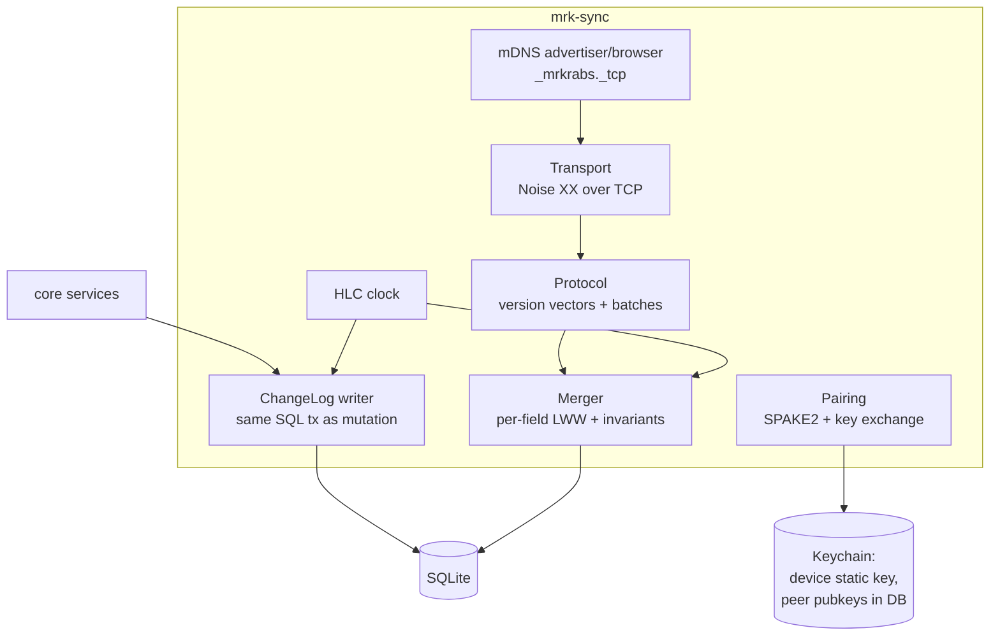
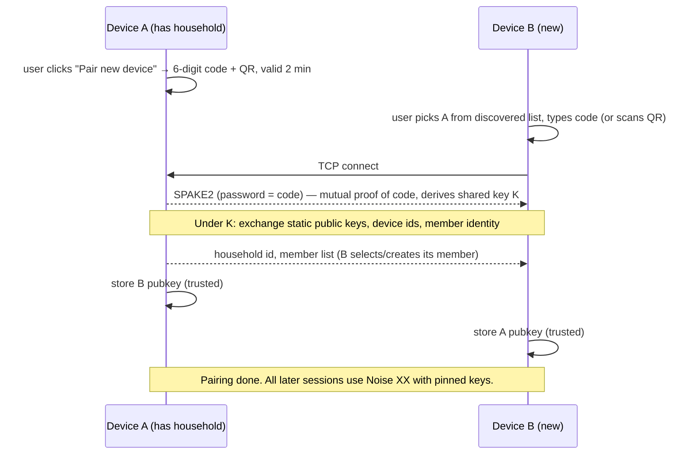
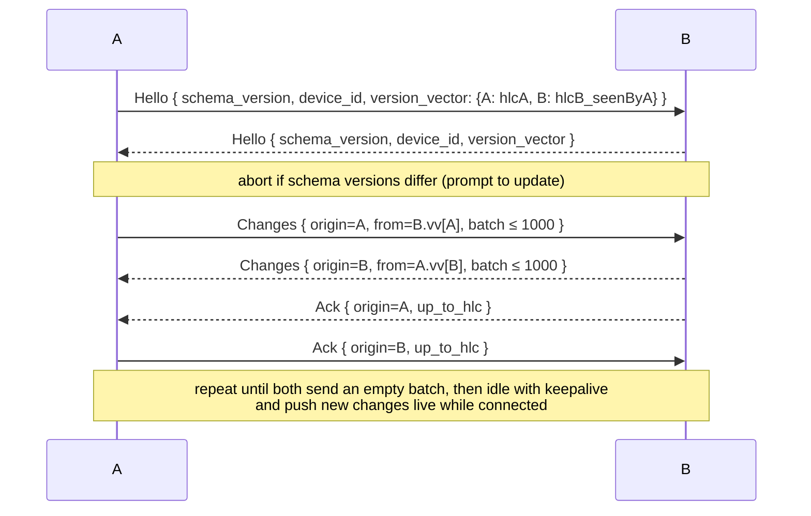

# 05 · Peer-to-Peer LAN Sync

Two Mr Krabs instances in the same household converge over the home LAN — no server, no cloud relay.

## Goals & non-goals
- ✅ Offline-first: each device is fully functional alone; sync is opportunistic.
- ✅ Deterministic convergence: same set of changes ⇒ same state on both devices, regardless of order.
- ✅ Authenticated, encrypted, explicitly paired devices only.
- ✅ Private data never leaves its owner's device.
- ❌ Internet/WAN sync, NAT traversal, relays (future: optional user-owned folder transport, see end).

## Components



## Identity & keys
- On first run each device generates a **static X25519 keypair** (Noise) stored in the **macOS Keychain**; the public key is in `device.public_key`.
- Device ID = UUIDv7; the household ID is created by the first device and adopted by the second during pairing.

## Discovery (mDNS / Bonjour)
- Service type `_mrkrabs._tcp.local`, random high TCP port.
- TXT record: `v=1`, `hh=<sha256(household_id)[0..8]>` (does not reveal the ID), `dev=<device_id short>`.
- Browsing only shows peers with matching household hash once paired; unpaired peers appear only while the pairing dialog is open.
- Crate: `mdns-sd` (pure Rust). Fallback: manual "connect to IP:port".

## Pairing (explicit, one time)



- SPAKE2 prevents an active attacker on the Wi-Fi from MITM-ing the key exchange without knowing the code; 3 wrong attempts invalidate the code.
- `sync_unpair` sets `revoked_at`; the revoked key is rejected at handshake.

## Transport
- **Noise_XX_25519_ChaChaPoly_BLAKE2s** (`snow` crate) over TCP; after the handshake each side checks the peer static key against its trust store.
- Framing: length-prefixed messages, **CBOR** (`ciborium`) payloads, `zstd` for batches > 4 KB.
- Rationale vs. TLS: no certificates or CA to manage; pinned raw keys fit a two-device trust model (see [ADR-0004](adr/0004-noise-protocol-for-lan.md)).

## Clocks: Hybrid Logical Clock
- `hlc: u64 = (physical_ms << 16) | counter` with `device_id` as final tiebreaker → total order `(hlc, device_id)`.
- Send/local event: `l' = max(l, now_ms)`; counter increments if `l'` unchanged.
- Receive: `l' = max(l, remote.l, now_ms)`, counter per HLC rules.
- Reject remote HLCs more than 24 h in the future (clock-skew guard); surface a warning.

## Change log
Every local mutation, **in the same SQLite transaction**, appends one row per entity to `change_log`:

```json
{ "change_id": "0193…", "hlc": 113553309184000017, "device_id": "A",
  "entity": "posting", "entity_id": "0193…", "op": "upsert",
  "fields": { "amount_minor": -45000, "category_id": "0192…" },
  "visibility": "household" }
```

and updates `field_clock(entity, entity_id, field) = (hlc, device)` for each changed field. Deletes are `op = "delete"` and set the tombstone `deleted = 1` (rows are never hard-deleted while any peer may still need them; compaction after all paired peers acknowledge).

### Visibility filtering
`visibility = "private"` is assigned by core for: entities of accounts with `visibility = private` (their entries, postings, reconciliations, import batches) and local-only tables. For `shared_summary` accounts, core emits **balance snapshots** (`account_balance_snapshot` change type) instead of the underlying postings. Private changes are **never sent**.

**The stored label is a write-time hint, not the rule** ([ADR-0012](adr/0012-sync-visibility-decided-at-send-time.md)). An account's visibility can change after its rows were logged, so the sender re-derives every change's visibility when it sends, from the row's **current** account and scope: postings, entries and reconciliations of `private` and `shared_summary` accounts never leave the device (a `shared_summary` account sends only balance snapshots), and `scope = personal` budget lines follow their member's account visibility. From M1, the change-log writer labels rows of private accounts `private` and everything else `household`.

## Sync protocol



- Version vector = `peer_state(origin_device_id → max_hlc)` — "highest change I have from each origin".
- Changes are relayed by origin, so the design generalizes to N devices (A↔B↔C) without changes.
- Idempotent: applying a `change_id` already in `change_log` is a no-op.

## Merge rules (deterministic, in Rust)

1. **Per-field last-writer-wins**: incoming field wins iff `(hlc, device_id) > field_clock` for that field. Edits to different fields of the same row both survive.
2. **Tombstones win over older edits**; an edit with higher HLC than the delete **does not resurrect** silently — it creates a `sync_conflict(kind = edit_vs_delete)` for the user.
3. **Entries are atomic for invariants**: a journal entry and its postings are sent in the same batch with a shared `group_id`; after applying, core re-validates the entry (balanced per currency). If merging produced an unbalanced entry (concurrent edits of different legs), core keeps the LWW result **and** raises `sync_conflict(kind = unbalanced_entry)`; reports exclude it until resolved.
4. **Reconciled entries are protected**: a remote edit of an entry that is `reconciled` locally produces a conflict instead of applying silently.
5. **Semantic duplicates**: two devices importing the same bank statement produce different IDs; after merge, core runs dedup (fingerprint) and raises `possible_duplicate` conflicts — or, if both rows came from imports of the same `file_sha256`, merges automatically keeping the lower UUID.
6. **Derived data is never synced.** Balances and reports are recomputed locally, so they cannot conflict.
7. **Constraints during apply**: a batch is applied in one transaction with `PRAGMA defer_foreign_keys = ON`, so parents and children may arrive in any order; foreign keys are checked at commit.
8. **Duplicate names**: a remote row that breaks a name key (live sibling categories with the same `name_key`; tags, payees or import profiles with the same name) is still applied. The row with the **higher id** is renamed `"<name> (2)"` (then 3, …) by a local write, and `sync_conflict(kind = duplicate_name)` lets the user merge them. Both devices pick the same row.
9. **Category cycles**: concurrent moves can form a cycle no single device wrote. After a batch, the merger walks the `parent_id` chain of every category whose parent changed. On a cycle, it makes the member with the highest `parent_id` field clock `(hlc, device)` a root of its kind, and raises `sync_conflict(kind = tree_cycle)`. Both devices hold the same field clocks, so they detach the same node.
10. **Merged categories**: a row that arrives referencing a category deleted by merge (`merged_into_id` set) is re-pointed, by a local write, to the end of the `merged_into_id` chain. A chain ending in a category deleted without a merge raises `edit_vs_delete`.
11. **Seeded rows are not changes**: rows written by the seeder (`hlc = 0`, `hlc_device = 'seed'`, [ADR-0008](adr/0008-deterministic-ids-for-seeded-rows.md)) are never in `change_log`. Each device seeds them itself, with identical ids.

## Testing strategy
- Property tests: random interleavings of operations on 2–3 simulated peers with random partitions ⇒ all peers converge to identical tables (excluding local-only), and every non-conflicted entry is balanced.
- Fuzz the frame decoder.
- Integration test: two app instances on loopback with real mDNS disabled (direct connect).

## Future (not v1)
- Optional **folder transport**: encrypted change batches written to a user-chosen synced folder (e.g. iCloud Drive) for when partners aren't on the same LAN — still $0 and serverless.
