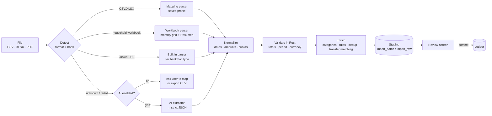

# 06 · Statement Ingestion & Optional AI

Import bank *cartolas* (account movements) and credit-card *estados de cuenta* into a **staging area**, review, then commit to the ledger. AI is an optional extractor — never a writer.

## Pipeline



### Stages
1. **Detect** — by extension, magic bytes, and text fingerprints (bank names, RUT of the bank, header patterns).
2. **Extract**
   - *Mapping* (CSV/XLSX via `csv`, `calamine`): profile defines columns (date, description, debit, credit / signed amount, optional category), date format (`dd/mm/yyyy`), thousands separator (`.`), decimal separator (`,`), skip rows. Works for any transaction table, not only bank exports.
   - *Household workbook* (XLSX via `calamine`, FR-IM-06): reads the twelve monthly sheets (category rows × day columns 1–31) and *Resumen*. Each non-empty day cell becomes a row dated `year-month-day` with the row label as its category; planned values become budget lines. Totals rows are recognized and skipped, and each month's rows must sum to that sheet's monthly total or the batch is flagged.
   - *Built-in PDF* (`pdf-extract`/`lopdf` text layer): per-bank parsers with golden-file tests. Initial targets are decided by which banks the household uses.
   - *AI* (optional): see below.
3. **Normalize** — to `ImportRow { date, description, amount: Money, installment: Option<(n, total)>, raw }`; CLP strings like `$1.234.567` or `-1.234.567` parsed exactly in Rust.
4. **Validate** — sum of movements must match the statement's totals when present (opening/closing balance, *total facturado*); dates within the statement period; currency matches the account (or section, for USD).
5. **Enrich** — category resolution in a fixed order: (1) a category named in the file, matched by name (FR-IM-07); (2) rules, by stage (FR-TX-10); (3) the local learned categorizer (FR-TX-12), which scores the description's words against the household's past categorizations; (4) the AI suggestion, only if AI is enabled. Each suggestion records its source so the review screen can explain it. **Dedup** against ledger (fingerprint `account | date±2d | amount | normalized description`, plus a match score per candidate, FR-TX-07) and within the batch; **transfer matching** (a −X in checking and +X in a card payment on the same/next day ⇒ suggest transfer instead of expense+income); **installments** (`Cuota 3/12`) linked to an existing plan or create one.
6. **Stage → Review → Commit** — every row has a decision (accept / skip / merge-with-existing). Commit writes all entries in **one SQL transaction** tagged with `import_batch_id`; `import_revert` soft-deletes them.

## Optional AI extractor

**Off by default.** Enabled in Settings → Import → "Use AI to read statements".

| Provider option | Cost | Privacy |
|---|---|---|
| **Local (Ollama / LM Studio, OpenAI-compatible endpoint on localhost)** — *recommended* | $0 | Statement never leaves the Mac |
| **User's own cloud API key** (Anthropic / OpenAI-compatible) | Paid by the user per use; app infra still $0 | Statement text is sent to that provider; explicit consent dialog per import |

- API keys are stored **only in the macOS Keychain** (via shell `secret_set`), never in SQLite, logs, backups or the repo.
- The provider sits behind a trait in `mrk-ai`:

```rust
#[async_trait]
pub trait StatementExtractor: Send + Sync {
    async fn extract(&self, doc: &StatementText, hints: &ExtractHints) -> Result<ExtractedStatement, AiError>;
}
```

### Contract
- Input: plain text (and, for scanned PDFs, page images if the model supports vision) + hints (expected currency, account kind, locale `es-CL`).
- Output: **strict JSON** validated with a JSON Schema in Rust (`schemars` + `jsonschema`); any non-conforming output is rejected.

```json
{
  "bank": "string|null",
  "document_type": "cartola|estado_de_cuenta_tc|otro",
  "period": { "from": "YYYY-MM-DD", "to": "YYYY-MM-DD" },
  "currency": "CLP",
  "opening_balance": "string|null",
  "closing_balance": "string|null",
  "total_billed": "string|null",
  "movements": [
    { "date": "YYYY-MM-DD", "description": "string", "amount": "-45990",
      "installment": { "number": 3, "of": 12 } | null,
      "section": "nacional|internacional|null" }
  ]
}
```

- Amounts are **strings** — parsed by Rust; the model never does arithmetic that we trust.
- Rust then runs the same **Validate** step: if extracted movements don't reconcile with the statement totals, the batch is flagged and every row is marked `issues: ["totals_mismatch"]`.
- Each row stores `confidence` and the batch stores `extractor = 'ai'` and `ai_provider` for auditability.
- The AI **never** writes to the ledger and never sees the existing ledger (no category history is sent unless the user enables "send category list for suggestions", which sends only category names).

### Prompting & safety
- System prompt fixed in code; statement text is passed as data with delimiters; output parsed only as JSON (no tool use, no instructions followed from the document).
- Large statements are chunked by page; results merged and de-duplicated in Rust.

## Review screen (UI)
- Table of staged rows: date, description, amount, suggested category (editable), payee, duplicate badge, transfer badge, cuota badge, issues.
- Header: statement period, totals check ✅/❌, extractor used, "Accept all suggestions", "Commit N rows".
- Learning: when the user changes a category, offer "Create rule: descriptions containing *X* → *Category*"; the change also trains the local categorizer.
- Unknown categories: a panel lists category names from the file that match nothing; each is mapped to an existing category or created on the spot. "Commit" stays disabled until all are resolved.

## Test fixtures — public repo rule
Real statements and the household's real workbook **must never be committed**. Golden-file tests use **synthetic statements** (and a synthetic workbook with the same sheet layout) generated by `tools/fixtures/` that mimic each bank's layout with fake names, RUTs, and amounts. `.gitignore` excludes `*.pdf`, `*.xlsx`, `*.csv` outside `fixtures/synthetic/`.
