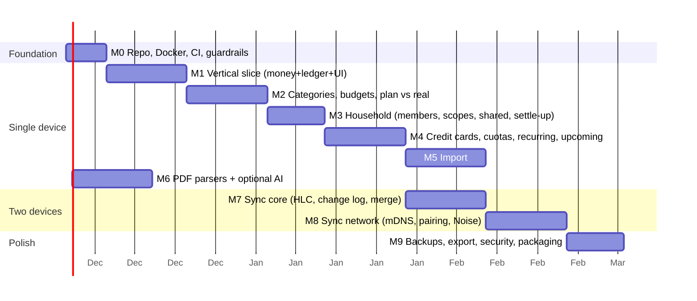

# 07 · Implementation Roadmap

Principle: **thin vertical slices**, each shippable and usable by the household. Sync comes only after the single-device ledger is trustworthy.

*(Dates are indicative; milestones are ordered by dependency, not deadlines.)*

---

### M0 · Foundation ✅
- Cargo workspace with all crates, pnpm workspace, Tauri v2 app scaffold, Vite + React + TS + Tailwind + shadcn/ui.
- **Docker development environment**: `docker compose up` runs `back` (Rust core behind the dev-only HTTP shell `mrk-devserver`), `front` (Vite) and `db` (read-only SQLite browser on the shared data volume); `test` profile runs all unit tests ([08-development](08-development.md), [ADR-0007](adr/0007-devserver-http-shell.md)).
- `@mr-krabs/api-client` with Tauri IPC and HTTP transports behind one typed API.
- First real code with unit tests: `mrk-money` (exact CLP/USD/UF parsing, formatting, allocation), `mrk-domain` (balanced double entry, transfer ≠ expense), `mrk-sync` (HLC), `mrk-store` (embedded migrations, no triggers), core command catalogue, devserver endpoints, React components.
- CI (GitHub Actions, free for public repos): branch policy, `cargo fmt`/`clippy -D warnings`/`cargo test`, ESLint (no `@tauri-apps` in UI), `tsc`, Vitest, Vite build, Tauri check on macOS, Docker build, SQL-logic guard, gitleaks.
- Guardrails: clippy bans `f32`/`f64` and float arithmetic workspace-wide.
- Repo process: MIT license, `dev → main` branching with protected branches ([CONTRIBUTING](../CONTRIBUTING.md)); committed lockfiles, CI installs locked/frozen.
- UI [design system](../design-system/mr-krabs/MASTER.md) with semantic light/dark tokens; shared agent memory in `.memory/`.
- **Done when:** `docker compose up` shows the UI talking to the core; `pnpm tauri dev` opens the app on macOS; CI green.

### M1 · Vertical slice — "record an expense and see the balance"
- **Progress:** libraries adopted ahead of the slice: `thiserror`, `proptest`, `insta`, `tracing-appender` file logs, `uuid` v7 + `jiff` declared; TanStack Router/Table/Virtual, `react-i18next`, `react-hook-form` + `zod`, shadcn Sonner/Command/Dialog/Chart. `mrk-money` items below are done (with property tests).
- `mrk-money`: `Money`, `CurrencyCode`, parse/format es-CL, `allocate`; property tests. ✅
- `mrk-domain`: `JournalEntry::validate` (balanced per currency), `account_balances`.
- `mrk-store`: migration runner, `0001_init.sql`, account + entry + posting repositories; writer actor + read pool; WAL.
- `mr-krabs-core`: `App` façade, `AccountService`, `TransactionService`; change-log writes already happen (sync-ready).
- Tauri: `app_bootstrap`, `household_create`, `account_*`, `tx_create/list/update/delete`, `money_parse`; specta bindings.
- UI: onboarding (household, base currency CLP), accounts sidebar with balances, transactions table, add/edit expense/income/transfer dialog.
- **Done when:** create a checking account, add expenses & a transfer to savings, balances correct; transfer not counted as expense; 100% of money logic covered by Rust tests.

### M2 · Categories, budgets, plan-vs-real (replaces the spreadsheet)
- Seed category tree (see [01](01-requirements.md#default-category-tree-seed-es-cl)) as ordinary, editable rows; savings/investments seeded as accounts.
- Category management: create, rename, move (any depth), archive, delete-with-merge; roll-up through the tree in reports and budgets (FR-BU-01, FR-BU-07, FR-BU-08).
- `budget_set`, `budget_copy_month`, `budget_matrix` (annual plan vs real, group subtotals, monthly cash flow, total expenses).
- `report_month_calendar` (day grid), `report_cash_flow`, `report_spending`.
- UI: Budget matrix page, Month calendar page, Dashboard (cash flow, spending by group).
- **Done when:** the household can run a month entirely in Mr Krabs instead of the spreadsheet.

### M3 · Household features
- Members, scopes (personal/household), visibility settings, view switcher (Personal / Household / Combined).
- Shared expenses with splits, attribution to member, external participants + receivables, settle-up.
- **Done when:** a month of shared expenses yields a correct "who owes whom".

### M4 · Credit cards & recurring
- Card accounts (limit, cycle, due day, national/international sections), installment plans + schedule, budget mode.
- Recurring rules (bills with expected, approximate or ranged amounts, salaries with pay-day window, subscriptions), `report_upcoming`, recurring-pattern detection and the "since last run" list (FR-TX-09).
- FX rates (manual + CSV), USD/UF support, `fx_exchange` entries; net worth report.

### M5 · Import I
- CSV/XLSX mapping profiles (with optional category column), staging tables, review UI, dedup with match scores, transfer matching, batch revert.
- Category resolution by name with the unknown-categories panel (FR-IM-07).
- **Household workbook import** (FR-IM-06): bring the spreadsheet's history and planned budgets in through staging.
- Rules engine with stages + "create rule" learning (FR-TX-10), local learned categorizer (FR-TX-12), learned-mappings screen (FR-IM-08).
- Synthetic fixtures generator (statements and a synthetic workbook).

### M6 · Import II (PDF + AI)
- Built-in PDF parsers for the household's banks (golden tests on synthetic PDFs).
- `mrk-ai` behind `--features ai`: Ollama/OpenAI-compatible + Anthropic providers, JSON-schema validation, totals reconciliation, consent dialog, Keychain-stored keys.

### M7 · Sync core (no network yet)
- HLC, version vectors, change batching, merge rules, visibility filtering, conflicts table + UI.
- Simulation property tests with 2–3 in-process peers.

### M8 · Sync network
- `mdns-sd` discovery, SPAKE2 pairing (code + QR), Noise XX transport (`snow`), live push while connected, unpair/revoke.
- **Done when:** two Macs edited offline for a week converge after one sync, with zero lost edits and duplicates flagged.

### M9 · Hardening & release
- Encrypted backups/restore, CSV export, optional SQLCipher at rest, Touch ID app lock.
- Signed & notarized `.dmg` (needs an Apple Developer account — the only potential cost, **optional**: unsigned builds work locally), GitHub Releases for distribution (free).
- es-CL / en translations, accessibility pass.

## Definition of done (every milestone)
- Rust tests for all new domain behavior; no money math outside Rust.
- No triggers/views/procedures; no secrets or personal data in the repo.
- Docs updated (requirements status, ADR if a decision changed).
