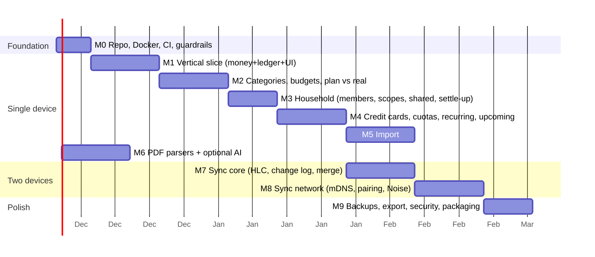

# 07 · Implementation Roadmap

Principle: **thin vertical slices**, each shippable and usable by the household. Sync comes only after the single-device ledger is trustworthy.

*(Dates are indicative; milestones are ordered by dependency, not deadlines.)*

---

### M0 · Foundation ✅
- Cargo workspace with all crates, pnpm workspace, Tauri v2 app scaffold, Vite + React + TS + Tailwind + shadcn/ui.
- **Docker development environment**: `docker compose up` runs `back` (Rust core behind the dev-only HTTP shell `mrk-devserver`), `front` (Vite) and `db` (read-only SQLite browser on the shared data volume); `test` profile runs all unit tests ([08-development](08-development.md), [ADR-0007](adr/0007-devserver-http-shell.md)).
- `@mr-krabs/api-client` with Tauri IPC and HTTP transports behind one typed API.
- First real code with unit tests: `mrk-money` (exact CLP/USD/UF parsing, formatting, allocation), `mrk-domain` (balanced double entry, transfer ≠ expense), `mrk-sync` (HLC), `mrk-store` (embedded migrations, no triggers), core command catalogue, devserver endpoints, React components.
- CI (GitHub Actions, free for public repos): branch policy, `cargo fmt`/`clippy -D warnings`/`cargo test`, ESLint (no `@tauri-apps` in UI), `tsc`, Vitest, Vite build, Tauri check on macOS, Docker build, SQL-logic guard, gitleaks.
- Guardrails: clippy bans `f32`/`f64` and float arithmetic workspace-wide.
- Repo process: MIT license, `dev → main` branching with protected branches ([CONTRIBUTING](../CONTRIBUTING.md)); committed lockfiles, CI installs locked/frozen.
- UI [design system](../design-system/mr-krabs/MASTER.md) with semantic light/dark tokens; shared agent memory in `.memory/`.
- **Done when:** `docker compose up` shows the UI talking to the core; `pnpm tauri dev` opens the app on macOS; CI green.

### M1 · Vertical slice — "record an expense and see the balance" ✅
- **Delivered** (PRs #17–#34 into `dev`, then the end-to-end journey; design review 2026-11-22):
  - `mrk-sync` persisted HLC clock and a local device (UUIDv7) created at first open; device key and member nullable until pairing (migration 0003); `Store::record_change` writes `change_log` + `field_clock` (changed fields `{old,new}`) in the same SQL transaction as every replicated mutation ([ADR-0010](adr/0010-change-log-from-m1.md)); seeded rows are deterministic and never logged ([ADR-0008](adr/0008-deterministic-ids-for-seeded-rows.md)).
  - `mrk-domain`: `JournalEntry::validate` (balanced per currency, archived accounts, account currency, transfer has no category leg), expansion of expense/income/transfer/opening balance into postings, in-place leg edits by role, `account_balances`, civil-date validation. Opening balances balance against an FX-trading leg ([ADR-0011](adr/0011-opening-balance-fx-leg.md)).
  - `mrk-money`: every built-in currency's display string parses back; a currency marker must match the target currency.
  - Core: 15 M1 commands behind one `commands::dispatch` shared by Tauri and the devserver — `app_bootstrap`, `household_create`, `settings_get`, `account_list` (with balances computed in Rust) / `account_get` / `account_create` (with opening balance) / `account_update` / `account_archive`, `category_tree`, `tx_create` / `tx_get` / `tx_list` (keyset paging) / `tx_update` / `tx_delete` / `tx_restore`. DTOs derive `specta::Type`; `packages/api-client/src/bindings.ts` is generated and checked for staleness. One synchronous `App` behind the shells' `Mutex`, one SQL transaction per command.
  - UI: app shell with accounts sidebar (grouped by kind, balances), onboarding (household, base currency CLP), account create/edit, transactions table (TanStack Table + Virtual, filters, keyset paging), add/edit expense/income/transfer dialog with the category picker, delete with an 8 s undo toast, per-device ES/EN toggle (REQ-14, brought forward from M9), server field errors mapped to `errors.field.*` copy.
  - Tooling: compose `test-back` applies migrations in order like CI; the schema guardrail fails when `foreign_key_check` itself errors.
  - **Done-when proved:** `apps/devserver/src/journey.rs` (`jrn1_m1_done_when_over_http_on_a_file_db`) runs the whole journey over HTTP on a file-backed database — household in CLP, checking with 1.000.000, expenses 45.990 and 12.500, transfer 100.000 to savings → checking $841.510, savings $100.000, the transfer unsigned with no category, a change-log row for every mutation from the local device with increasing HLC, the same balances after reopening the file.
- **Follow-ups moved to M2:**
  - Process (X-10): the stage-ledger checker can't express "confirmed, routed to another PR"; a `routed: X-n` closure goes to the skills repo, not this one.
  - Account query key (X-11): later UI keeps the single `["accounts"]` namespace and invalidates it after every transaction write.
  - Transaction dialog (#33): F18, a stale form-level message after a server error is resolved; F19, a fail-then-recover path re-sends the transaction's stored category (an archived one is refused with a visible field error).
  - Transactions table and dialog minors (#31): refetch every loaded page after a write (F8); a missing account yields an empty currency (F22); an unknown `accountId` in the URL (F33); a row hint for assistive tech (F35); Cancel during a write (F42); dotted field paths map to the form root (F48); test gaps (F20, F21, F36); and F37–F39, F51, F52 (listed in #31).
- **Progress (before the slices):** libraries adopted ahead of the slice: `thiserror`, `proptest`, `insta`, `tracing-appender` file logs, `uuid` v7 + `jiff` declared; TanStack Router/Table/Virtual, `react-i18next`, `react-hook-form` + `zod`, shadcn Sonner/Command/Dialog/Chart.
- `mrk-money`: `Money`, `CurrencyCode`, parse/format es-CL, `allocate`; property tests. ✅
- `mrk-domain`: `JournalEntry::validate` (balanced per currency), `account_balances`. ✅
- `mrk-store`: migration runner, `0001_init.sql`, account + entry + posting repositories; WAL. ✅ (writer actor + read pool arrive with M7, see [02](02-architecture.md))
- `mr-krabs-core`: `App` façade, `AccountService`, `TransactionService`; every mutation writes `change_log` + `field_clock` in the same transaction, stamped by the local device's HLC ([ADR-0010](adr/0010-change-log-from-m1.md)). ✅
- Tauri: `app_bootstrap`, `household_create`, `account_*`, `tx_create/list/update/delete`, `money_parse`; specta bindings. ✅
- UI: onboarding (household, base currency CLP), accounts sidebar with balances, transactions table, add/edit expense/income/transfer dialog. ✅
- **Done when:** create a checking account, add expenses & a transfer to savings, balances correct; transfer not counted as expense; 100% of money logic covered by Rust tests. ✅ (every money path is in Rust with unit, property or acceptance tests; no coverage tool measures the percentage yet)
- **Slices** (one PR each into `dev`; design review 2026-11-22):
  - Wave 1, in parallel: `fix/compose-schema-step` (compose test profile applies migrations in order, like CI) · `feat/sync-stamps` (HLC clock, local device, change-log writer, device-key migration) · `feat/ledger-domain` (`JournalEntry::validate`, transaction expansion, in-place leg edits, `account_balances`) · `feat/api-contract` (specta bindings, all M1 DTOs and commands as `NOT_IMPLEMENTED` stubs).
  - Wave 2: `feat/household-accounts` (after sync-stamps, ledger-domain, api-contract) · `feat/ui-onboarding-accounts` and `feat/ui-transactions` (after api-contract).
  - Wave 3: `feat/transactions` (after household-accounts) · `feat/m1-journey` (end-to-end check through the devserver, docs status; last). All merged.

### M2 · Categories, budgets, plan-vs-real (replaces the spreadsheet)
- Seed category tree (see [01](01-requirements.md#default-category-tree-seed-es-cl)) as ordinary, editable rows; savings/investments seeded as accounts.
- Category management: create, rename, move (any depth), archive, delete-with-merge; roll-up through the tree in reports and budgets (FR-BU-01, FR-BU-07, FR-BU-08).
- `budget_set`, `budget_copy_month`, `budget_matrix` (annual plan vs real, group subtotals, monthly cash flow, total expenses).
- `report_month_calendar` (day grid), `report_cash_flow`, `report_spending`.
- UI: Budget matrix page, Month calendar page, Dashboard (cash flow, spending by group).
- **Done when:** the household can run a month entirely in Mr Krabs instead of the spreadsheet.

### M3 · Household features
- Members, scopes (personal/household), visibility settings, view switcher (Personal / Household / Combined).
- Shared expenses with splits, attribution to member, external participants + receivables, settle-up.
- **Done when:** a month of shared expenses yields a correct "who owes whom".

### M4 · Credit cards & recurring
- Card accounts (limit, cycle, due day, national/international sections), installment plans + schedule, budget mode.
- Recurring rules (bills with expected, approximate or ranged amounts, salaries with pay-day window, subscriptions), `report_upcoming`, recurring-pattern detection and the "since last run" list (FR-TX-09).
- FX rates (manual + CSV), USD/UF support, `fx_exchange` entries; net worth report.

### M5 · Import I
- CSV/XLSX mapping profiles (with optional category column), staging tables, review UI, dedup with match scores, transfer matching, batch revert.
- Category resolution by name with the unknown-categories panel (FR-IM-07).
- **Household workbook import** (FR-IM-06): bring the spreadsheet's history and planned budgets in through staging.
- Rules engine with stages + "create rule" learning (FR-TX-10), local learned categorizer (FR-TX-12), learned-mappings screen (FR-IM-08).
- Synthetic fixtures generator (statements and a synthetic workbook).

### M6 · Import II (PDF + AI)
- Built-in PDF parsers for the household's banks (golden tests on synthetic PDFs).
- `mrk-ai` behind `--features ai`: Ollama/OpenAI-compatible + Anthropic providers, JSON-schema validation, totals reconciliation, consent dialog, Keychain-stored keys.

### M7 · Sync core (no network yet)
- HLC, version vectors, change batching, merge rules, visibility filtering, conflicts table + UI.
- Simulation property tests with 2–3 in-process peers.

### M8 · Sync network
- `mdns-sd` discovery, SPAKE2 pairing (code + QR), Noise XX transport (`snow`), live push while connected, unpair/revoke.
- **Done when:** two Macs edited offline for a week converge after one sync, with zero lost edits and duplicates flagged.

### M9 · Hardening & release
- Encrypted backups/restore, CSV export, optional SQLCipher at rest, Touch ID app lock.
- Signed & notarized `.dmg` (needs an Apple Developer account — the only potential cost, **optional**: unsigned builds work locally), GitHub Releases for distribution (free).
- es-CL / en translations, accessibility pass.

## Parallel tracks after M1
Milestones above are listed in dependency order, but not all of them depend on each other. Once M1 is done, three tracks can run side by side (starting each is the owner's call):
- **Ledger:** M2 → { M3 ‖ M4 } → M5. M3 (members, scopes, settle-up) doesn't need budgets; M4 needs M2's categories and budget mode; M5 needs M2 and M4.
- **Sync:** M8's transport (mDNS, pairing, Noise) needs only M1's device identity; M7's merge engine can start on M1's change log and add per-entity rules as M2–M4 add tables. Starting sync before M4 relaxes the principle at the top of this page, so it needs the owner's go.
- **Edges:** M6's PDF parsers and the `mrk-ai` provider are pure and can start after M1 (their staging commit waits for M5); M9's packaging is independent, and backups wait for the schema to settle after M5.

## Definition of done (every milestone)
- Rust tests for all new domain behavior; no money math outside Rust.
- No triggers/views/procedures; no secrets or personal data in the repo.
- Docs updated (requirements status, ADR if a decision changed).
