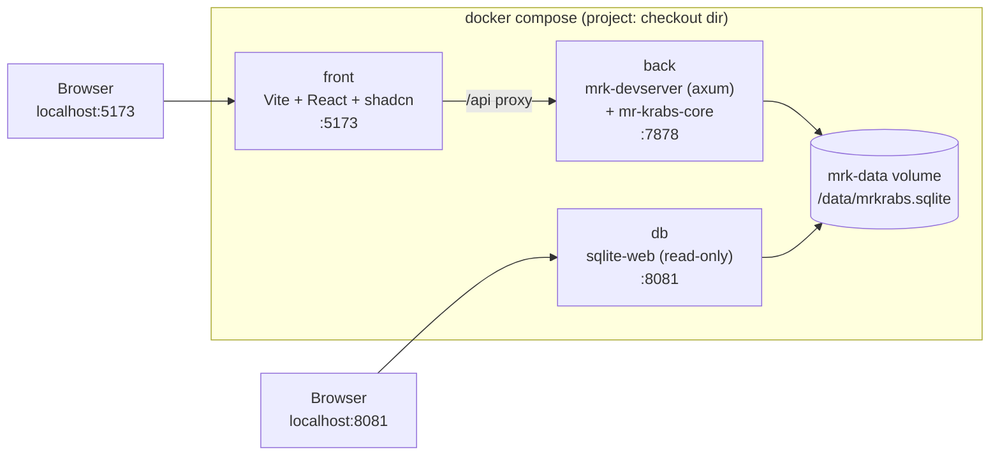

# 08 · Development Environment

Development runs in **Docker** so every machine gets the same toolchain. The shipped product is the Tauri desktop app; in Docker the same `mr-krabs-core` runs behind a small **dev-only HTTP shell** so the UI can be developed in a browser ([ADR-0007](adr/0007-devserver-http-shell.md)).

## Services



| Service | What it runs | Port | Notes |
|---|---|---|---|
| `back` | `cargo watch … run -p mrk-devserver` | 7878 | Hot-reloads on changes in `crates/` and `apps/devserver/`. First start compiles everything (several minutes). |
| `front` | `vite` dev server | 5173 | Proxies `/api/*` to `back`. `@mr-krabs/api-client` auto-selects the HTTP transport in the browser. |
| `db` | `sqlite-web --read-only` | 8081 | SQLite is an embedded file, not a server: this service shares the data volume and lets you browse tables. Writes go only through the core. |
| `test-back` *(profile `test`)* | `cargo test --workspace` | – | Rust unit tests. |
| `test-front` *(profile `test`)* | `pnpm lint && typecheck && test` | – | Frontend unit tests. |

## Everyday commands

```bash
docker compose up --build            # start back + front + db
docker compose logs -f back          # follow the core
docker compose --profile test run --rm test-back
docker compose --profile test run --rm test-front
docker compose down                  # stop (keeps data)
docker compose down -v               # stop and wipe data + caches
```

`Cargo.lock` and `pnpm-lock.yaml` are committed and CI installs from them frozen; commit any change to them along with the manifest change that caused it.

The compose project name comes from the checkout directory, so each git worktree gets its own volumes (build cache and dev DB). Ports are fixed and bound to `127.0.0.1`, so run one worktree's stack at a time.

## Native (desktop app)

The Tauri window must run natively on macOS:

```bash
# prerequisites: Rust (rustup), Node 22, pnpm (corepack enable), Xcode CLT
pnpm install
pnpm tauri dev          # opens the desktop app, UI talks to Rust over IPC
pnpm tauri build        # .app / .dmg in target/release/bundle
```

## Native (without Docker)

```bash
cargo test --workspace --exclude mr-krabs-desktop
cargo run -p mrk-devserver               # http://127.0.0.1:7878, DB in ./.data/
pnpm install && pnpm dev                 # http://localhost:5173
pnpm lint && pnpm typecheck && pnpm test
```

## Endpoints (devserver)

| Method | Path | Purpose |
|---|---|---|
| `GET` | `/api/health` | Core health (version, schema). Used by the compose healthcheck. |
| `GET` | `/api/commands` | Command catalogue. |
| `POST` | `/api/invoke/{command}` | Same commands as Tauri, JSON args/result. Errors: `422` validation, `404` unknown, `500` internal. |

The devserver binds to `0.0.0.0` only inside the container; it is never packaged with the app.
